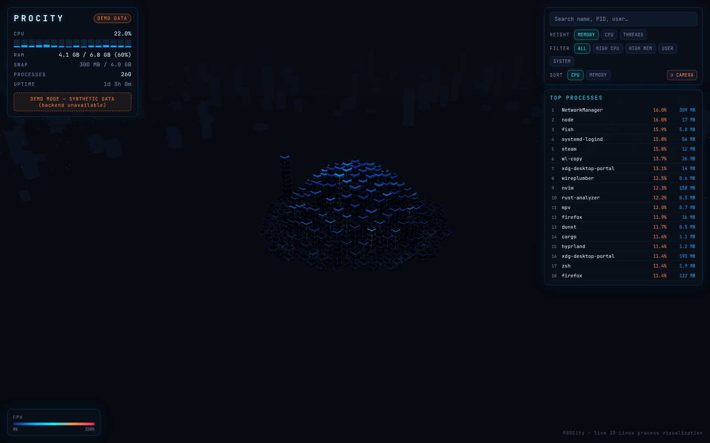
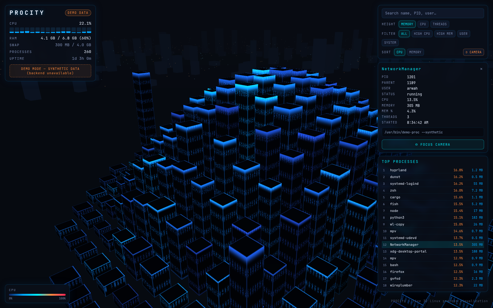

# Linux Process City (PROCity)

A real-time system-monitoring app for Omarchy Linux (Arch + Hyprland): every running
process is a skyscraper in a neon cyberpunk city. Building **height** = memory (RSS),
building **color** = CPU usage, all driven by live `psutil` data over a local
WebSocket. Not a mockup — actual PIDs, actual usage, updating every second.



Screenshots use the application's **synthetic demo mode**. Live mode reads actual local process metrics; the screenshots do not expose the host's running processes.



 

## Features

- **Live 3D city** — instanced building geometry, with a configurable default limit of 1,000 processes
- **Process mapping** — stable identity (`pid:create_time`, PID-recycling safe),
  stable slot per process, smooth height/color interpolation, spawn/despawn animations
- **HUD** — CPU (with per-core bars), RAM, swap, GPU (NVIDIA via pynvml/nvidia-smi
  with graceful fallback), process count, uptime, truncation notice
- **Details panel** — click a building: name, PID, PPID, user, status, CPU, memory,
  threads, start time, command line; Focus Camera button
- **Search** — by name, PID, or username; flies to + highlights the building
- **Filters** — All / High CPU / High Mem / User / System (dims non-matching),
  sort by CPU or memory, Top Processes list
- **Camera** — drag rotate, scroll zoom, right-drag pan, double-click focus,
  reset button, smooth tweened transitions
- **Modes** — Live, Overview, Focus, Resource (height metric: MEM/CPU/THREADS),
  Demo (synthetic data, clearly labeled, auto-engages when backend is unreachable)
- **Security** — localhost-only binding, no sudo, no process killing/modification,
  no process memory inspection, validated API inputs, auto-reconnect

## Layout

```
backend/    FastAPI + psutil monitor + GPU fallback (+ tests)
frontend/   Three.js city + HUD/panels (TypeScript, Vite)
scripts/    install.sh / run.sh / uninstall.sh
hyprland/   optional Hyprland window rules
```

## How it works

```text
Linux process metrics (psutil) + optional NVIDIA GPU metrics
                         |
                  FastAPI monitor
                 /api/* and /ws
                         |
               TypeScript state updates
                         |
           Three.js city + HUD + process panel
```

The backend samples process metadata and streams snapshots over WebSocket. The frontend maps each process to a stable city slot using its PID and creation time, which avoids treating a recycled PID as the same process. Building height can represent memory, CPU, or thread count; color indicates CPU activity. Filters dim buildings without removing their spatial context.

## Portable manual setup

Requires Python 3.10+ (3.14 used for this validation), Node.js/npm compatible with the included Vite toolchain, and a WebGL-capable browser. Linux is the primary target; NVIDIA monitoring is optional. Omarchy/Hyprland is only needed for the optional desktop integration.

```bash
git clone https://github.com/arwvah/procity.git
cd procity
python3 -m venv backend/.venv
backend/.venv/bin/python -m pip install -r backend/requirements.txt
cd frontend
npm ci
npm run build
cd ../backend
.venv/bin/python -m uvicorn main:app --host 127.0.0.1 --port 8901
```

Open **http://127.0.0.1:8901**. To serve synthetic data, prefix the final command with `PROCITY_DEMO=1`. The optional installer below also creates a local launcher; manual setup does not change desktop configuration.

## API

| Endpoint | Purpose |
| --- | --- |
| `GET /api/health` | Version, availability and demo status |
| `GET /api/snapshot` | System metrics and current process snapshot |
| `GET /api/processes` | Process list, truncation status and display limit |
| `GET /api/processes/{pid}?create_time=...` | Process details with optional PID-reuse protection |
| `WS /ws` | Recurring snapshots at the configured interval |

Keep the service bound to loopback: the local API exposes process metadata and has no authentication. It is a read-only visualization; it does not terminate processes or inspect their memory contents.

## Install (Omarchy / Arch)

```bash
git clone https://github.com/arwvah/procity.git
cd procity
scripts/install.sh
```

Checks python3/node/npm, creates `backend/.venv`, installs backend deps
(fastapi, uvicorn, psutil, nvidia-ml-py, pydantic), installs frontend deps
(three, typescript, vite, vitest), builds the production frontend, and installs
a `procity` launcher into `~/.local/bin`.

## Run

```bash
scripts/run.sh            # live mode, opens a standalone app window
scripts/run.sh --demo     # demo mode (synthetic data)
```

Or manually:

```bash
cd backend && .venv/bin/python -m uvicorn main:app --host 127.0.0.1 --port 8901
# open http://127.0.0.1:8901/
```

Press Ctrl+C (or close the app window) to stop; the backend shuts down cleanly.

## Environment variables

| Variable           | Default | Meaning                              |
|--------------------|---------|--------------------------------------|
| `PROCITY_PORT`     | `8901`  | HTTP/WS port (localhost only)        |
| `PROCITY_INTERVAL` | `1.0`   | Monitoring update interval (seconds) |
| `PROCITY_MAX`      | `1000`  | Max buildings shown (top by CPU+RAM) |
| `PROCITY_DEMO`     | `0`     | `1` = serve synthetic demo data      |

## Hyprland integration (optional)

Copy the rules from `hyprland/procity.conf` into your `hyprland.conf` for a
dedicated floating/fullscreen window. Nothing is modified automatically.

## Tests

```bash
backend/.venv/bin/python -m pip install -r backend/requirements-dev.txt
backend/.venv/bin/python -m pytest backend/tests -q   # backend: 21 tests
cd frontend && npm test                               # frontend logic: 19 tests
```

Validation on October 13, 2026: **21 backend tests and 19 frontend tests passed**, and the production frontend build succeeded. Backend tests currently emit FastAPI/Starlette deprecation warnings.

## Known limitations

- The server-side `PROCITY_DEMO=1` stream currently retains the LIVE connection badge, and its synthetic memory totals may be inconsistent. The screenshots use the clearly labeled frontend offline fallback demo instead.

- Other users' processes may show limited fields (cmdline/username) without root —
  by design; the app never requires sudo.
- The run script detects app-window close via the browser process; if the window
  hands off to an already-running browser instance, stop PROCity with Ctrl+C.
- Rendering verified via headless-browser screenshot + API/WS checks in CLI;
  interactive picking/camera behavior was verified in the desktop environment.
